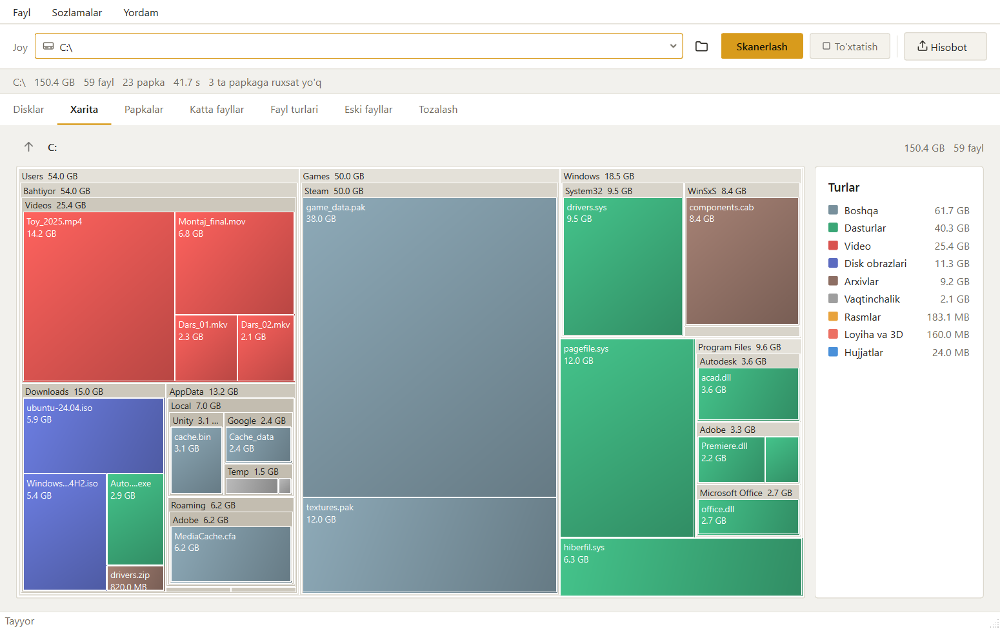
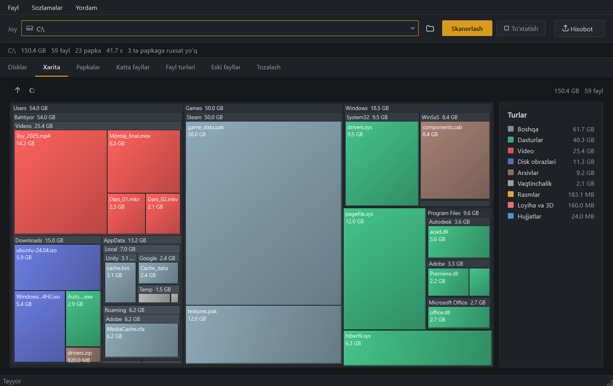
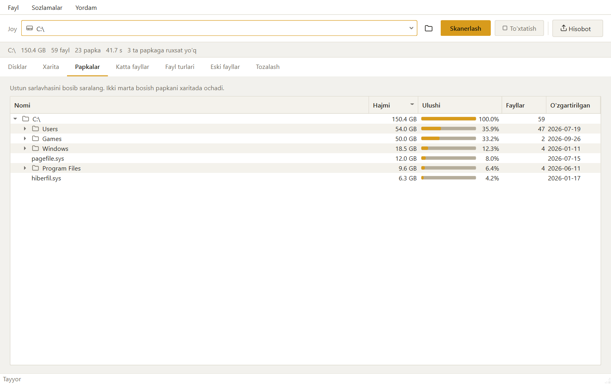
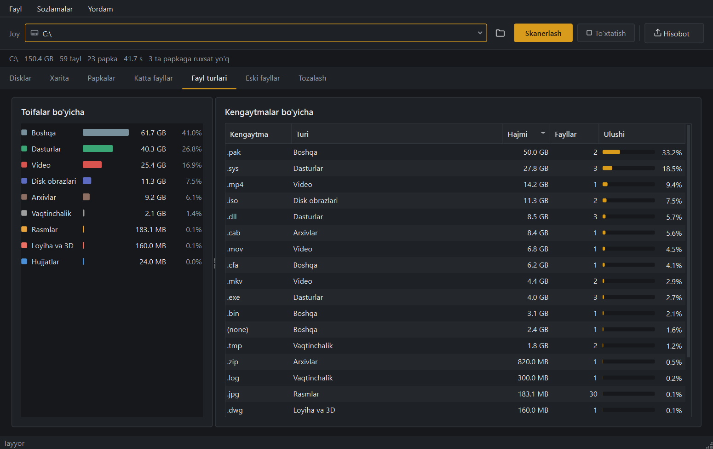
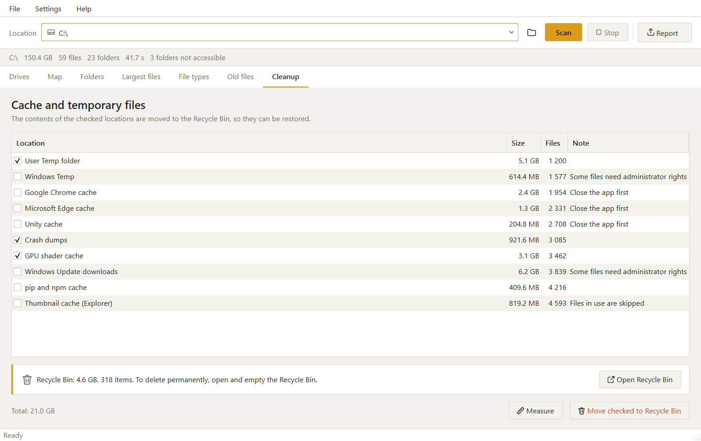
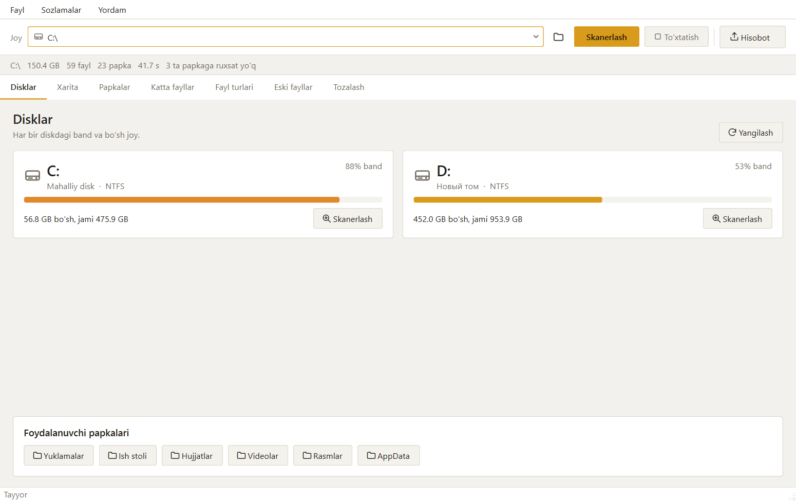

<h1 align="center">Disk tahlilchisi</h1>

<b>Disk Analyzer</b> · Анализатор дисков

   
  
  
  
  

Disk va papkalarda joyni nima egallayotganini ko'rsatadi: papkalar xaritasi, eng katta va eski fayllar, fayl turlari statistikasi, kesh va vaqtinchalik fayllarni Savatga tozalash.

## Imkoniyatlar

- Disklar bo'yicha band va bo'sh joy
- Ko'p oqimli tez skanerlash, istalgan payt to'xtatish mumkin
- Papkalar xaritasi (treemap): papkani bosib ichiga kirish
- Hajm, ulush va fayllar soni bo'yicha saralanadigan papkalar daraxti
- Eng katta 100 ta fayl va fayl turlari statistikasi
- Uzoq vaqt ochilmagan katta fayllar
- Brauzer, Unity, Adobe keshlari va Temp papkalarini tozalash
- O'chirish faqat Savatga, tasdiqlash bilan
- HTML va CSV hisobot

## Xavfsizlik

- Fayllar faqat Savatga yuboriladi (Send2Trash), har safar tasdiqlash so'raladi.
- Disk ildizi, `Windows`, `Program Files`, `ProgramData` va foydalanuvchi papkalarining o'zi himoyalangan.
- Skanerlash faqat o'qiydi. Junction va symlink'larga kirilmaydi.

## O'rnatish

1. [**DiskTahlilchisi.exe**](https://github.com/eduhakimov/disk-tahlilchisi/releases/latest/download/DiskTahlilchisi.exe) faylini yuklab oling.
2. Faylni ishga tushiring, o'rnatish shart emas.
3. Windows SmartScreen ogohlantirsa: **Batafsil → Baribir ishga tushirish**.

**Tizim talablari:** Windows 10 (1809+) / Windows 11, x64

---

## Русский

Показывает, что занимает место на дисках и в папках: карта папок, самые большие и старые файлы, статистика по типам файлов, очистка кэша и временных файлов в Корзину.

- Занятое и свободное место по дискам
- Быстрое многопоточное сканирование с возможностью остановки
- Карта папок (treemap) с переходом внутрь по щелчку
- Дерево папок с сортировкой по размеру, доле и числу файлов
- 100 самых больших файлов и статистика по типам
- Большие файлы, которые давно не открывались
- Очистка кэша браузеров, Unity, Adobe и папок Temp
- Удаление только в Корзину и с подтверждением
- Отчёт в HTML и CSV

## English

Shows what takes up space on drives and in folders: a folder map, the largest and oldest files, file type statistics, and cleanup of cache and temporary files to the Recycle Bin.

- Used and free space per drive
- Fast multithreaded scan that can be stopped at any time
- Folder map (treemap) with click-to-open
- Folder tree sortable by size, share and file count
- The 100 largest files and file type statistics
- Large files that have not been opened for a long time
- Cleanup of browser, Unity and Adobe caches and Temp folders
- Deletion only to the Recycle Bin, with confirmation
- HTML and CSV reports

---

## Muallif / Author

**Bahtiyorjon Hakimov** (Hakimov Bahtiyorjon Muzaffar o'g'li), [github.com/eduhakimov](https://github.com/eduhakimov)

© 2026 Bahtiyorjon Hakimov. Barcha huquqlar himoyalangan. / Все права защищены. / All rights reserved.
Batafsil: [LICENSE](LICENSE) · Uchinchi tomon komponentlari: [THIRD_PARTY_NOTICES.md](THIRD_PARTY_NOTICES.md)
