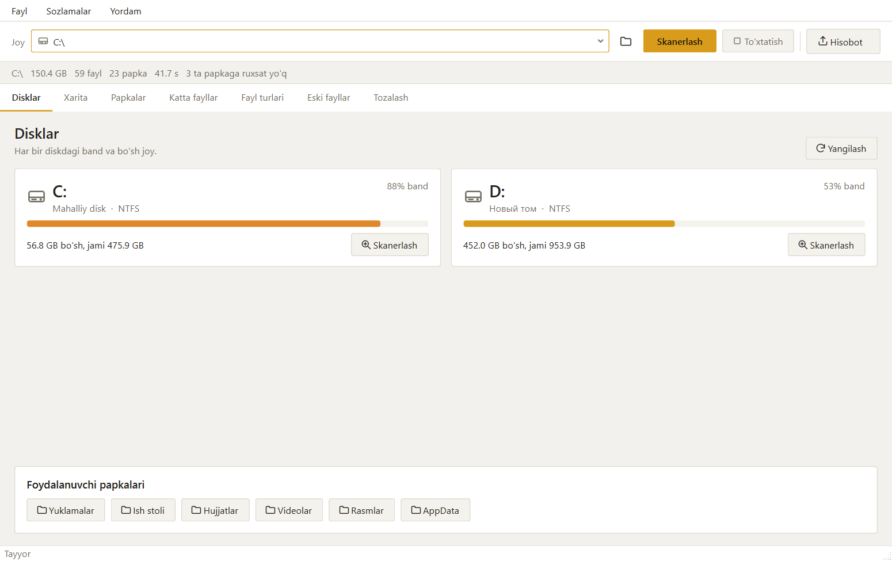
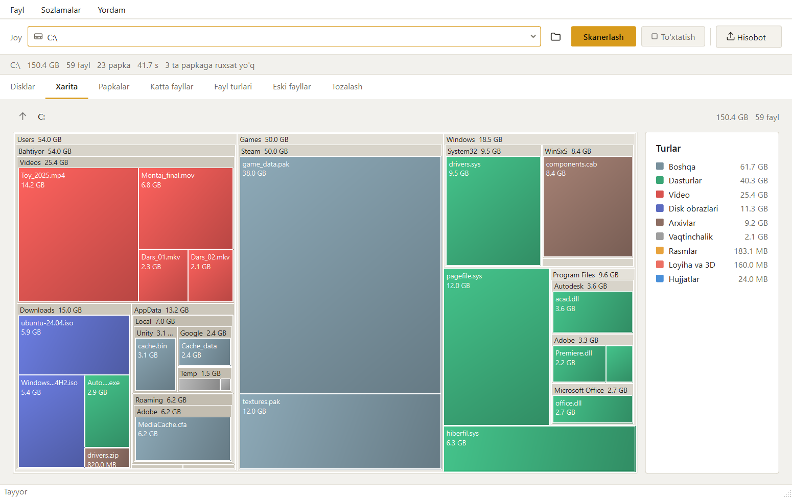
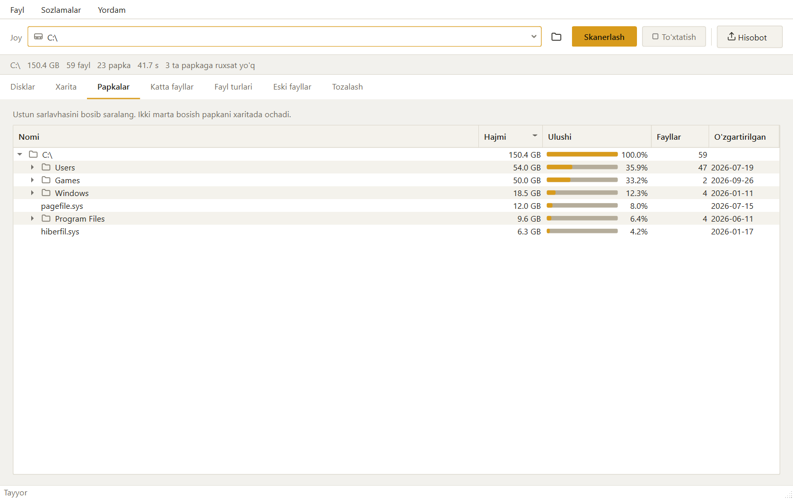
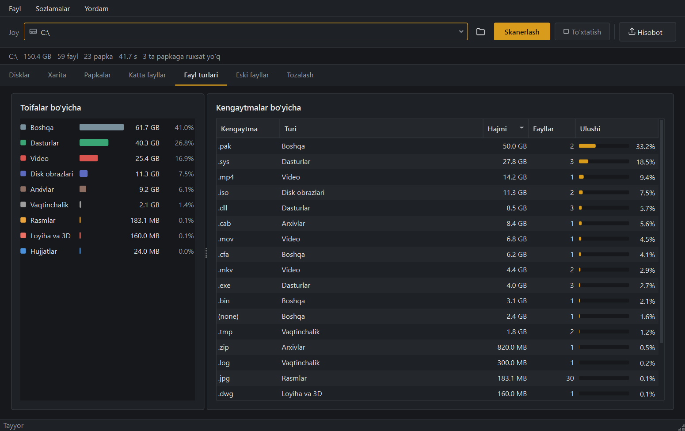
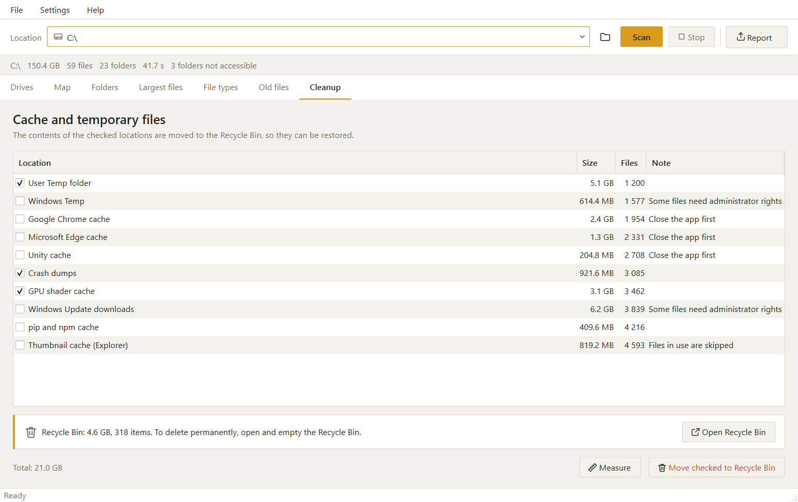
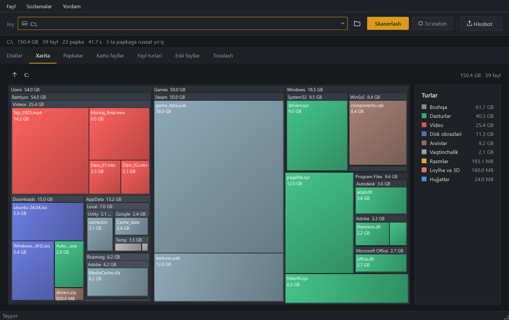

# Disk tahlilchisi: Foydalanish qo‘llanmasi

Muallif: Hakimov Bahtiyorjon. Versiya: 1.0.2.

## 1. Umumiy ma’lumot

“Disk tahlilchisi” kompyuterdagi disklar va papkalarda joyni nima egallayotganini ko‘rsatadigan dastur. U diskni yoki tanlangan papkani skanerlaydi va natijani papkalar xaritasi, papkalar daraxti, eng katta fayllar ro‘yxati, fayl turlari statistikasi va uzoq vaqt ochilmagan fayllar ro‘yxati ko‘rinishida beradi. Shuningdek, dastur brauzerlar, Unity, Adobe va boshqa dasturlarning keshi hamda vaqtinchalik fayllarni Savatga yuborish orqali tozalaydi.

Dastur quyidagi foydalanuvchilar uchun mo‘ljallangan:

- disk to‘lib qolgan va joyni nima egallayotganini bilmoqchi bo‘lgan har qanday kompyuter foydalanuvchisi;
- tashkilot va o‘quv muassasalarida kompyuterlarga xizmat ko‘rsatuvchi mutaxassislar;
- katta hajmdagi video, rasm va loyiha fayllari bilan ishlaydigan dizaynerlar, montajchilar va dasturchilar;
- informatika va axborot texnologiyalari fanlari o‘qituvchilari va talabalari.
Dastur faylni hech qachon to‘g‘ridan-to‘g‘ri butunlay o‘chirmaydi: barcha o‘chirishlar Windows Savatiga yuboriladi va har safar tasdiq so‘raladi.

Dastur yordamida quyidagi savollarga tez javob olish mumkin: qaysi disk to‘lib qolgan, qaysi papka eng ko‘p joy egallaydi, qaysi fayllar eng katta, qaysi turdagi fayllar ko‘p, qaysi katta fayllar uzoq vaqt ochilmagan va kesh hamda vaqtinchalik fayllar qancha joy egallaydi. Natijani hisobot sifatida saqlab, boshqa mutaxassisga berish ham mumkin.

## 2. Tizim talablari

- Operatsion tizim: Windows 10 (1809 versiyasi va undan keyingi) yoki Windows 11, 64 bitli (x64).
- Internet ulanishi talab qilinmaydi: dastur to‘liq oflayn ishlaydi.
- O‘rnatish talab qilinmaydi: dastur bitta bajariladigan fayl ko‘rinishida tarqatiladi.
- Administrator huquqi oddiy ishlash uchun shart emas. Biroq Windows Temp va Windows Update yuklamalari kabi tizim joylarini tozalashda ba’zi fayllar uchun administrator huquqi kerak bo‘lishi mumkin.
- Interfeys tillari: o‘zbek, rus va ingliz.

## 3. O‘rnatish va ishga tushirish

1. Brauzerda dasturning GitHub sahifasini oching: https://github.com/eduhakimov/disk-tahlilchisi.
2. Releases (relizlar) bo‘limidan eng so‘nggi versiyadagi DiskTahlilchisi.exe faylini yuklab oling.
3. Faylni qulay papkaga saqlang va ikki marta bosib ishga tushiring. O‘rnatish jarayoni yo‘q, dastur darhol ochiladi.
4. Birinchi ishga tushirishda Windows SmartScreen “Windows kompyuteringizni himoya qildi” mazmunidagi ogohlantirish chiqarishi mumkin. Bunda “Batafsil” havolasini bosing, so‘ng “Baribir ishga tushirish” tugmasini bosing.
Dasturni yangilash uchun yangi versiyadagi .exe faylni yuklab olib, eskisining o‘rniga qo‘yish kifoya. Sozlamalar alohida papkada saqlangani uchun ular yo‘qolmaydi.

## 4. Dastur oynasi bilan tanishish

Oynaning eng yuqorisida “Fayl”, “Sozlamalar” va “Yordam” menyulari joylashgan. Ularning ostida boshqaruv paneli bor:

- “Joy” maydoni: ochiladigan ro‘yxatdan diskni tanlash yoki papka yo‘lini qo‘lda yozish mumkin;
- papka belgisi tushirilgan tugma: papkani oyna orqali tanlash (“Papka tanlash”);
- “Skanerlash” tugmasi: tanlangan joyni skanerlashni boshlaydi;
- “To‘xtatish” tugmasi: davom etayotgan skanerlashni to‘xtatadi;
- “Hisobot” tugmasi: natijani HTML yoki CSV ko‘rinishida saqlaydi.
Panel ostida natija satri ko‘rinadi. Skanerlash davomida unda qancha fayl va qancha hajm o‘qilgani chiqadi, tugagandan keyin esa yo‘l, umumiy hajm, fayllar va papkalar soni, sarflangan soniyalar hamda ruxsat berilmagan papkalar soni ko‘rsatiladi.

Asosiy maydon yettita yorliqdan iborat: “Disklar”, “Xarita”, “Papkalar”, “Katta fayllar”, “Fayl turlari”, “Eski fayllar” va “Tozalash”. Oynaning eng pastki qismidagi holat satrida qisqa xabarlar chiqadi, masalan, xaritada sichqoncha turgan element yo‘li yoki hisobot saqlangan joy.

Yorliqlar haqida qisqacha: “Disklar” barcha disklar holatini, “Xarita” papkalarning ko‘rgazmali xaritasini, “Papkalar” aniq raqamli daraxtni, “Katta fayllar” eng katta 100 ta faylni, “Fayl turlari” toifa va kengaytmalar statistikasini, “Eski fayllar” uzoq vaqt ochilmagan yoki o‘zgartirilmagan katta fayllarni, “Tozalash” esa kesh va vaqtinchalik fayllar joylarini ko‘rsatadi. “Disklar” va “Tozalash” sahifalari skanerlashsiz ham ishlaydi, qolgan sahifalar skanerlash natijasidan keyin to‘ladi.

*1-rasm. Dastur oynasi: yuqorida menyular va boshqaruv paneli, ostida natija satri va yorliqlar, “Disklar” sahifasida C: va D: disklari*

*2-rasm. “Xarita” yorlig‘i: namunaviy C: diski uchun papkalar xaritasi va “Turlar” izohi*

## 5. Asosiy amallar

**Diskni skanerlash.**

1. “Disklar” yorlig‘ini oching. Har bir disk kartochkasida band joy foizi, bo‘sh va umumiy hajm ko‘rsatilgan.
2. Kerakli disk kartochkasidagi “Skanerlash” tugmasini bosing yoki yuqoridagi “Joy” ro‘yxatidan diskni tanlab, paneldagi “Skanerlash” tugmasini bosing.
3. Skanerlash davomida natija satrida o‘qilgan fayllar soni va hajmi yangilanib turadi. Kerak bo‘lsa, “To‘xtatish” tugmasini bosing; bunda natija “To‘xtatildi, natija to‘liq emas” belgisi bilan ko‘rsatiladi.
4. Skanerlash tugagach, dastur avtomatik ravishda “Xarita” yorlig‘iga o‘tadi.
Disklar ro‘yxatini yangilash uchun “Disklar” sahifasidagi “Yangilash” tugmasidan foydalaning. Foydalanuvchi papkalarini tez tekshirish uchun “Foydalanuvchi papkalari” blokidagi “Yuklamalar”, “Ish stoli”, “Hujjatlar”, “Videolar”, “Rasmlar” yoki “AppData” tugmasini bosing.

**Papkani skanerlash.**

1. “Joy” maydoni yonidagi papka tugmasini bosing.
2. Ochilgan oynada papkani tanlang va tasdiqlang.
3. “Skanerlash” tugmasini bosing. Agar yozilgan yo‘l mavjud bo‘lmasa, dastur “Bunday papka topilmadi” xabarini chiqaradi.
**Xarita bilan ishlash.**

1. “Xarita” yorlig‘ida har bir to‘rtburchak papka yoki faylni bildiradi: to‘rtburchak qancha katta bo‘lsa, shuncha ko‘p joy egallaydi. Fayllar turiga qarab ranglanadi, ranglar izohi o‘ng tomondagi “Turlar” blokida.
2. Papkani bosib, uning ichiga kiring. Oldingi darajaga qaytish uchun yuqoridagi “Yuqoriga” (strelka) tugmasini bosing.
3. Sichqoncha o‘ng tugmasi bilan element ustida menyuni oching: “Explorer’da ko‘rsatish”, “Shu papkani xaritada ochish” yoki “Savatga yuborish”.
Mayda fayllar bitta “N ta mayda fayl” to‘rtburchagiga birlashtirilgan bo‘ladi.

**Papkalar daraxti.**

1. “Papkalar” yorlig‘ini oching. Har bir qatorda Nomi, Hajmi, Ulushi, Fayllar va O‘zgartirilgan ustunlari bor.
2. Ustun sarlavhasini bosib saralang, masalan, “Hajmi” bo‘yicha kamayish tartibida.
3. Papka yonidagi uchburchakni bosib uni oching. Papkani ikki marta bosish uni xaritada ochadi.
4. O‘ng tugma menyusi orqali elementni Explorer’da ko‘rsatish yoki Savatga yuborish mumkin.
**Katta va eski fayllar.**

1. “Katta fayllar” yorlig‘ida skanerlangan joydagi eng katta 100 ta fayl Nomi, Hajmi, Turi, O‘zgartirilgan va Papka ustunlari bilan ko‘rsatiladi.
2. “Eski fayllar” yorlig‘ida “Kamida” maydoniga minimal hajmni (MB) kiriting, ro‘yxatdan “Oxirgi ochilgan sana” yoki “O‘zgartirilgan sana” mezonini tanlang va kunlar sonini belgilang. Standart qiymatlar: 100 MB va 180 kun.
3. Jadval pastida topilgan fayllar soni va umumiy hajmi ko‘rsatiladi.
4. Faylni tanlab, “Papkasini ochish” tugmasi bilan uning papkasini oching yoki “Savatga yuborish” tugmasi bilan Savatga yuboring. Ctrl yoki Shift tugmasi bilan bir nechta qatorni birga tanlash mumkin.
**Fayl turlari.** “Fayl turlari” yorlig‘ining chap qismida “Toifalar bo‘yicha” diagramma (Video, Rasmlar, Audio, Hujjatlar, Arxivlar, Disk obrazlari, Dasturlar, Kod, Loyiha va 3D, Vaqtinchalik, Boshqa), o‘ng qismida “Kengaytmalar bo‘yicha” jadval joylashgan.

**Kesh va vaqtinchalik fayllarni tozalash.**

1. “Tozalash” yorlig‘ini oching. Ro‘yxatda faqat kompyuteringizda mavjud bo‘lgan joylar chiqadi.
2. “Hajmini hisoblash” tugmasini bosing: har bir joyning hajmi va fayllar soni hisoblanadi.
3. Tozalanadigan joylarni belgilang. Standart holatda “Foydalanuvchi Temp papkasi”, “Xatolik damplari” va “Videokarta sheyder keshi” belgilangan. “Izoh” ustunidagi ogohlantirishlarga e’tibor bering: brauzer, Unity va Adobe keshi uchun “Avval dasturni yoping”.
4. “Belgilanganlarni Savatga” tugmasini bosing va tasdiqlash oynasida ro‘yxatni tekshirib, roziligingizni bering.
5. Natija xabarida Savatga yuborilgan va o‘tkazib yuborilgan elementlar soni ko‘rsatiladi. Band yoki himoyalangan fayllar o‘tkazib yuboriladi.
6. Joyni butunlay bo‘shatish uchun “Savatni ochish” tugmasini bosib, Savatni Windows vositasi bilan tozalang.
**Hisobot saqlash.**

1. Skanerlashdan keyin “Hisobot” tugmasini bosing va “HTML hisobot” yoki “CSV fayl” bandini tanlang.
2. Saqlash joyini ko‘rsating. Standart holatda Hujjatlar papkasi taklif qilinadi.
3. HTML hisobot saqlangandan keyin brauzerda avtomatik ochiladi. CSV faylni Excel yoki boshqa jadval dasturida ochish mumkin.
**Hisobot tarkibi.** HTML hisobotda sarlavha, skanerlangan yo‘l, umumiy hajm, fayllar soni va hisobot tuzilgan sana, so‘ng uchta jadval beriladi: eng katta 50 ta papka (hajm, ulush chizig‘i, foiz va fayllar soni), toifalar bo‘yicha hajm va eng katta fayllar ro‘yxati. CSV faylida esa papkalar, eng katta fayllar va kengaytmalar bo‘yicha jadvallar bo‘sh qator bilan ajratilgan holda yoziladi, hajmlar baytlarda beriladi va ustunlar nuqtali vergul bilan ajratiladi. CSV fayl UTF-8 kodlashida saqlanadi, shuning uchun o‘zbek va rus harfli nomlar Excel’da to‘g‘ri ko‘rinadi.

*3-rasm. “Papkalar” yorlig‘i: Users, Games, Windows va boshqa papkalar hajmi va ulushi bo‘yicha saralangan*

*4-rasm. “Fayl turlari” yorlig‘i: toifalar diagrammasi va kengaytmalar jadvali (qorong‘i mavzu)*

*5-rasm. Tozalash sahifasi ingliz tilidagi interfeysda: belgilangan joylar, hajm, izohlar va Savat ma’lumoti*

## 6. Sozlamalar

“Sozlamalar” menyusida ikki band bor.

- “Til”: O‘zbekcha, Русский yoki English. Tilni o‘zgartirish uchun dastur qayta ishga tushiriladi, buning uchun tasdiq so‘raladi.
- “Mavzu”: “Yorug‘”, “Qorong‘i” yoki “Tizim bo‘yicha”. Mavzu Windows sozlamalariga mos tanlanishi ham mumkin.
“Eski fayllar” sahifasida kiritilgan minimal hajm va kunlar soni ham saqlanadi va keyingi ishga tushirishda tiklanadi.

“Yordam” menyusida “Qo‘llanma” va “Dastur haqida” bandlari joylashgan.

*6-rasm. Qorong‘i mavzudagi “Xarita” sahifasi*

## 7. Ma’lumotlarni saqlash va xavfsizlik

Dastur sozlamalari foydalanuvchi papkasidagi %APPDATA%\BahtiyorSoft\disk-tahlilchisi papkasida settings.json faylida saqlanadi. Xatoliklar jurnali shu papkadagi log.txt fayliga yoziladi. Hisobotlar faqat siz ko‘rsatgan joyga saqlanadi.

Dastur xavfsizligi quyidagi qoidalarga asoslangan:

- Skanerlash faqat o‘qish rejimida bajariladi, fayllar o‘zgartirilmaydi.
- Junction va symlink’lar ichiga kirilmaydi.
- O‘chirish faqat Savatga bajariladi, fayllarni Savatdan qaytarish mumkin.
- Har bir o‘chirishdan oldin elementlar soni, hajmi va ro‘yxati bilan tasdiq so‘raladi.
- Disk ildizi, Windows, Program Files, ProgramData papkalari va ularning ichi (Windows Temp, Windows Update yuklamalari va Minidump bundan mustasno), foydalanuvchi profili papkasining o‘zi, AppData, profil ichidagi Ish stoli, Hujjatlar, Yuklamalar kabi asosiy papkalarning o‘zi va boshqa foydalanuvchilar profillari himoyalangan. Bunday joyni o‘chirishga urinilsa, “Bu tizim joyi, uni o‘chirib bo‘lmaydi” xabari chiqadi.
- Tozalashda papkalarning o‘zi emas, faqat ichidagi fayllar Savatga yuboriladi.
- Dastur internetga ulanmaydi va hech qanday ma’lumot yubormaydi.

## 8. Ko‘p uchraydigan savollar va muammolar

**Natija satrida “N ta papkaga ruxsat yo‘q” yozuvi chiqdi. Bu xatomi?** Yo‘q. Ba’zi tizim papkalarini oddiy foydalanuvchi o‘qiy olmaydi. Bunday papkalar hajmi umumiy natijaga kirmaydi.

**Diskning band joyi va skanerlangan hajm bir xil emas. Nima uchun?** Ruxsat berilmagan papkalar va junction orqali bog‘langan joylar hisoblanmaydi. Bundan tashqari, Savatdagi fayllar va tizim tomonidan band qilingan maydon farq qilishi mumkin.

**Fayllarni Savatga yubordim, lekin bo‘sh joy ko‘paymadi.** Savatdagi fayllar diskda joy egallashda davom etadi. “Tozalash” sahifasidagi “Savatni ochish” tugmasi orqali Savatni tozalang. Yangi hajmlarni ko‘rish uchun qayta skanerlang.

**Tozalashdan keyin “O‘tkazib yuborildi” soni noldan katta.** Ochiq dasturlar ishlatayotgan band fayllar yoki administrator huquqi talab qiladigan fayllar o‘tkazib yuboriladi. Brauzer keshini tozalashdan oldin brauzerni yoping.

**“Eski fayllar” ro‘yxati bo‘sh yoki kutilganidan boshqacha.** Windows oxirgi ochilgan sanani har doim ham yangilamaydi. “O‘zgartirilgan sana” mezoni bo‘yicha tekshirib ko‘ring, minimal hajm va kunlar sonini kamaytiring.

**“Hisobot” tugmasi bosilganda “Avval disk yoki papkani skanerlang” xabari chiqadi.** Hisobot faqat skanerlash natijasi asosida tuziladi, avval skanerlashni bajaring.

**Papka nima uchun o‘chirilmayapti?** Ehtimol, u himoyalangan joylar ro‘yxatiga kiradi. Bunday holatda kerakli fayllarni papka ichidan tanlab o‘chiring.

**Skanerlash juda uzoq davom etmoqda.** Fayllar soni ko‘p bo‘lgan disklarni skanerlash ko‘proq vaqt oladi. “To‘xtatish” tugmasi bilan jarayonni to‘xtatib, kichikroq papkani tanlashingiz mumkin.

**Savatga yuborilgan faylni qanday qaytaraman?** Savatni oching (masalan, “Tozalash” sahifasidagi “Savatni ochish” tugmasi orqali), faylni toping va sichqoncha o‘ng tugmasi menyusidagi “Qaytarish” bandini tanlang. Fayl asl joyiga qaytadi.

**Til o‘zgarmadi.** Tilni tanlagandan keyin dastur qayta ishga tushirish uchun tasdiq so‘raydi. Tasdiqlang yoki dasturni yopib, qayta oching.

**Xaritada “N ta mayda fayl” degan to‘rtburchak nima?** Dastur xotirani tejash uchun har bir papkada eng katta 40 ta faylni alohida ko‘rsatadi, qolgan fayllarni bitta guruhga birlashtiradi. Bu guruh ustida o‘ng tugma menyusidan “Explorer’da ko‘rsatish” bandi papkaning o‘zini ochadi.

