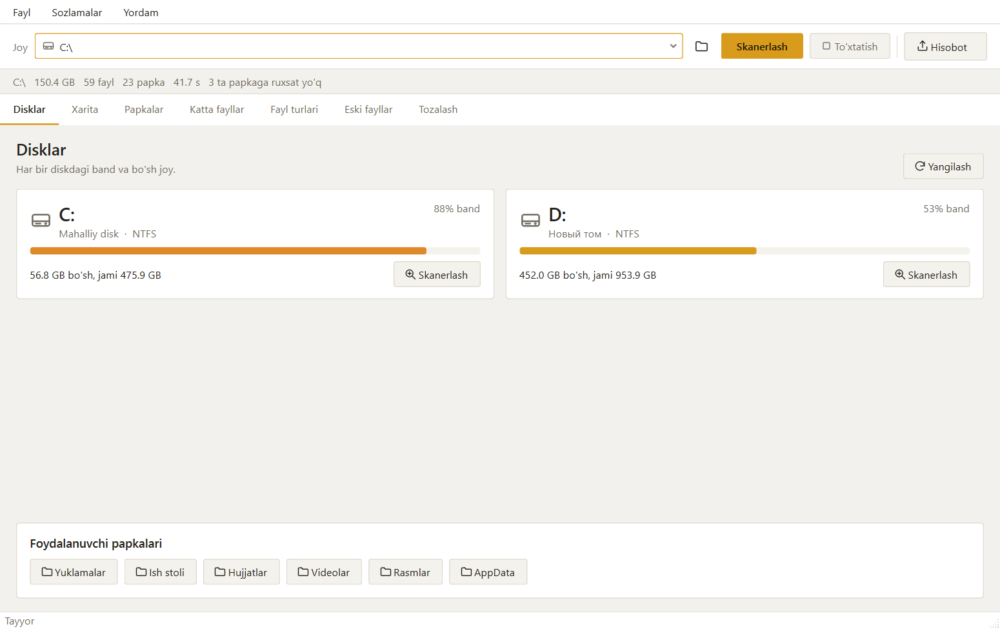
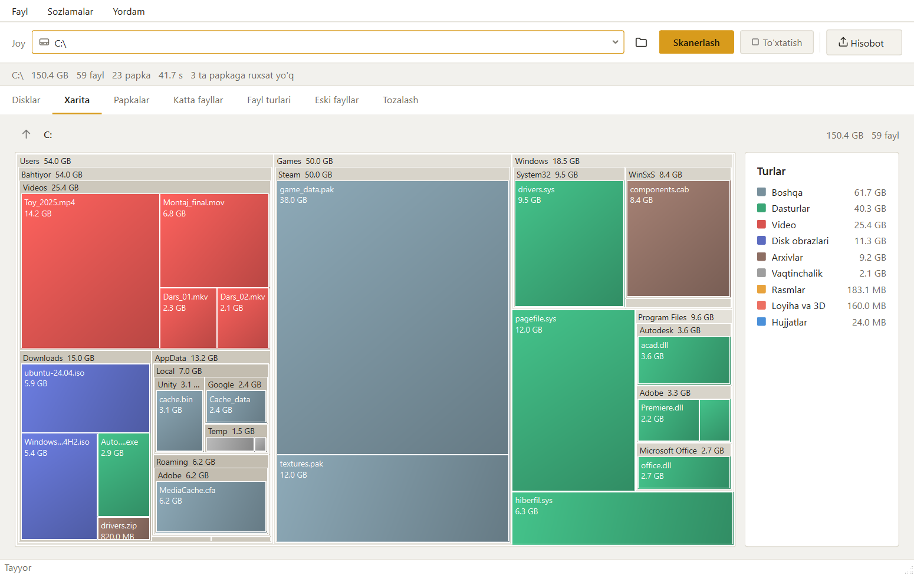
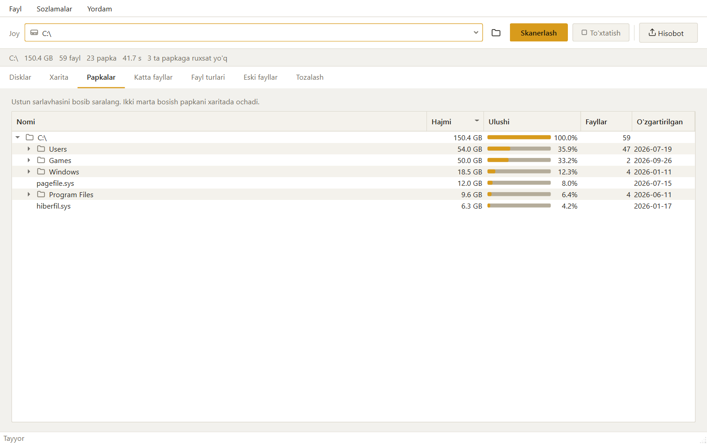
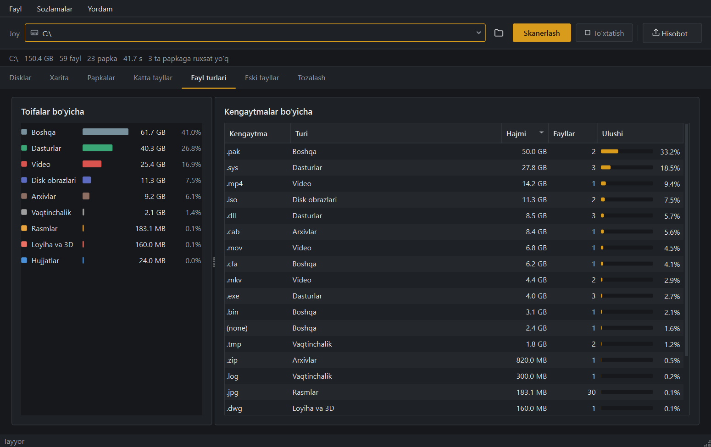
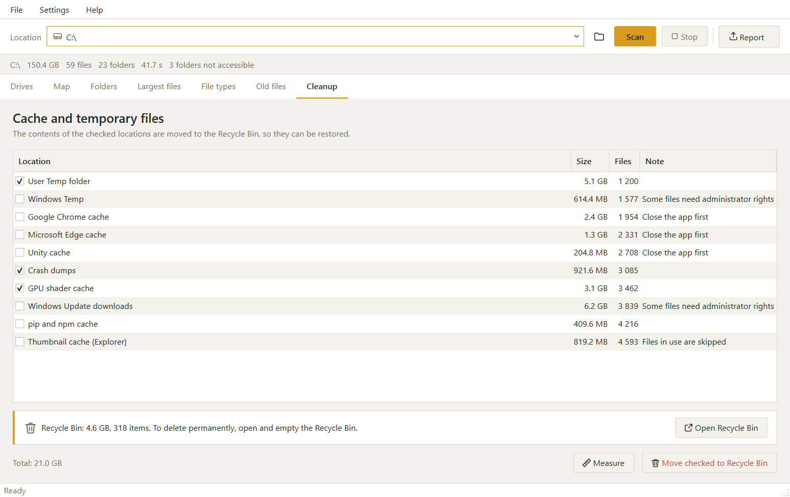

UDK: 004.42

# Disk maydonidan foydalanishni tahlil qilish va xavfsiz tozalash uchun oflayn dasturiy vosita: ko‘p oqimli skanerlash, squarified treemap vizualizatsiyasi va himoyalangan o‘chirish mexanizmi

**Hakimov Bahtiyorjon**  
*[ish joyi, lavozimi, elektron pochta]*

**Annotatsiya.** Maqolada Windows 10 va 11 operatsion tizimlarida disk va papkalardagi joy qanday taqsimlanganini aniqlash hamda keraksiz kesh va vaqtinchalik fayllarni xavfsiz tozalash uchun ishlab chiqilgan “Disk tahlilchisi” dasturi tavsiflanadi. Dastur Python 3.12 va PySide6 (Qt 6) asosida yaratilgan, internetsiz ishlaydi. Papkalar daraxti navbat va bir nechta oqim yordamida o‘qiladi, natija squarified treemap algoritmi asosidagi papkalar xaritasi, saralanadigan daraxt, eng katta 100 ta fayl ro‘yxati, fayl turlari statistikasi va uzoq vaqt ochilmagan fayllar ko‘rinishida beriladi. O‘chirish faqat Windows Savatiga, foydalanuvchi tasdig‘i bilan bajariladi, tizim papkalari dastur darajasida himoyalangan. Arxitektura, xavfsizlik choralari va avtomatik testlar natijalari keltiriladi.

*Kalit so‘zlar:* disk maydoni, papkalar xaritasi, squarified treemap, ko‘p oqimli skanerlash, Savat, kesh tozalash, PySide6, oflayn dastur.

**Офлайн-программное средство для анализа использования дискового пространства и безопасной очистки: многопоточное сканирование, визуализация squarified treemap и защищённый механизм удаления**

**Аннотация.** В статье описывается программа «Disk tahlilchisi» (анализатор дисков), разработанная для определения того, как распределено место на дисках и в папках в Windows 10 и 11, а также для безопасной очистки ненужного кэша и временных файлов. Программа создана на Python 3.12 и PySide6 (Qt 6) и работает без интернета. Дерево папок читается с помощью очереди и нескольких потоков, результат представляется в виде карты папок на основе алгоритма squarified treemap, сортируемого дерева, списка 100 самых больших файлов, статистики типов файлов и давно не открывавшихся файлов. Удаление выполняется только в Корзину Windows с подтверждением пользователя, системные папки защищены на уровне программы. Приводятся архитектура, меры безопасности и результаты автоматических тестов.

*Ключевые слова:* дисковое пространство, карта папок, squarified treemap, многопоточное сканирование, Корзина, очистка кэша, PySide6, офлайн-программа.

**An offline software tool for disk space usage analysis and safe cleanup: multithreaded scanning, squarified treemap visualization and a protected deletion mechanism**

**Abstract.** The paper describes “Disk tahlilchisi” (Disk Analyzer), a program developed to determine how space is distributed across drives and folders in Windows 10 and 11 and to safely clean up unneeded cache and temporary files. The program is built with Python 3.12 and PySide6 (Qt 6); it works offline. The folder tree is read using a work queue and several threads, and the result is presented as a folder map based on the squarified treemap algorithm, a sortable tree, a list of the 100 largest files, file type statistics and files that have not been opened for a long time. Deletion is performed only to the Windows Recycle Bin after user confirmation, and system folders are protected at the application level. Architecture, safety measures and test results are presented.

*Keywords:* disk space, folder map, squarified treemap, multithreaded scanning, Recycle Bin, cache cleanup, PySide6, offline software.

## Kirish

Tashkilotlar, ta’lim muassasalari va xonadonlardagi kompyuterlarda saqlanadigan ma’lumotlar hajmi muntazam ortib boradi. Video darslar, loyiha fayllari, o‘rnatuvchi paketlar, disk obrazlari, brauzer va ilovalar keshi asta-sekin tizim diskini to‘ldiradi. Disk to‘lib qolganda operatsion tizim yangilanishlari o‘rnatilmay qoladi, ilovalar vaqtinchalik fayl yoza olmaydi, foydalanuvchi esa joyni nima egallayotganini bilmagan holda tasodifiy fayllarni o‘chirishga majbur bo‘ladi. Bunday vaziyatda muhim hujjatlarni yo‘qotish xavfi paydo bo‘ladi.

Windows Explorer har bir papkaning umumiy hajmini ro‘yxatda ko‘rsatmaydi, papka xususiyatlarini bittalab ochib hajmni aniqlash esa ko‘p vaqt talab qiladi. Shuning uchun disk maydonining tuzilishini bir qarashda ko‘rsatadigan, eng katta va eng eski fayllarni ajratib beradigan hamda keraksiz fayllarni qaytarish imkoniyatini saqlagan holda tozalaydigan vosita amaliy ehtiyojga aylanadi.

Raqamlashtirish jarayonlari, jumladan, “Raqamli O‘zbekiston – 2030” strategiyasida belgilangan vazifalar davlat va ta’lim tashkilotlarida kompyuter texnikasidan foydalanish ko‘lamini kengaytirmoqda. Kompyuter parkiga xizmat ko‘rsatadigan mutaxassislar uchun internetga bog‘liq bo‘lmagan, o‘zbek tilidagi interfeysga ega va xavfsiz ishlaydigan tizim vositalari zarur. Ushbu maqolada shu ehtiyojga javob sifatida ishlab chiqilgan “Disk tahlilchisi” dasturining vazifasi, arxitekturasi, asosiy algoritmlari va xavfsizlik choralari bayon qilinadi.

Disk maydonini tahlil qilish vazifasi faqat joy bo‘shatish bilan cheklanmaydi. Papkalar hajmining taqsimoti foydalanuvchining ish uslubini, saqlanayotgan ma’lumotlar turini va ularning dolzarbligini aks ettiradi. Masalan, uzoq vaqt ochilmagan katta video yoki disk obrazlari arxivlash yoki tashqi tashuvchiga ko‘chirish uchun nomzod bo‘ladi, keshlar esa ilovalar tomonidan qayta yaratiladigan ma’lumotlardir. Demak, vosita ma’lumotlarni toifalarga ajratishi va har bir toifa bo‘yicha foydalanuvchiga ongli qaror qabul qilish imkonini berishi kerak.

Dastur o‘zbek, rus va ingliz tillarida ishlaydi, yorug‘ va qorong‘i mavzularni qo‘llab-quvvatlaydi va o‘rnatishni talab qilmaydigan bitta bajariladigan fayl ko‘rinishida tarqatiladi. Dastur kodi muallifning GitHub sahifasida joylashtirilgan.

## Muammoning qo‘yilishi va mavjud yechimlar tahlili

Disk maydonini tahlil qilish masalasini quyidagicha ifodalash mumkin: berilgan disk yoki papka uchun barcha ichki papkalarning to‘liq hajmini (ichidagi barcha fayllar yig‘indisini) hisoblash, natijani foydalanuvchi tez tushunadigan shaklda ko‘rsatish va keraksiz ma’lumotlarni tizim barqarorligiga zarar yetkazmasdan olib tashlash. Masala uchta talabni o‘z ichiga oladi: skanerlash tezligi va to‘xtatilishi mumkinligi, natijaning ko‘rgazmaliligi hamda o‘chirish amalining xavfsizligi.

Mavjud yechimlarni umumiy holda bir necha turga ajratish mumkin.

- Operatsion tizimning o‘rnatilgan vositalari. Windows tarkibida disk tozalash va xotira sozlamalari mavjud. Ular tizim tomonidan belgilangan toifalar bo‘yicha ishlaydi, lekin foydalanuvchining o‘z papkalari tuzilishini batafsil ko‘rsatish ularning asosiy vazifasi emas.
- Disk maydonini vizual tahlil qiluvchi alohida dasturlar. Bu turdagi vositalar papkalar daraxti va to‘rtburchaklar xaritasi (treemap) ko‘rinishidagi tasvirdan foydalanadi. Ular orasida bepul va tijorat dasturlari bor, interfeys tili va litsenziya shartlari har xil.
- Tizimni “tozalovchi” umumiy dasturlar. Ular keshni, reestrni va boshqa joylarni avtomatik tozalashni taklif qiladi. Bunday vositalarda nima o‘chirilayotganini foydalanuvchi har doim ham aniq ko‘rmaydi.
- Buyruq satri vositalari. Ular moslashuvchan, lekin oddiy foydalanuvchi va talaba uchun natijani talqin qilish qiyin.
Ushbu turdagi yechimlarni tanlashda tashkilot uchun quyidagi mezonlar muhim: interfeysning o‘zbek tilida bo‘lishi, internet talab qilinmasligi, o‘rnatishsiz ishlashi, o‘chirish amali qaytariladigan bo‘lishi va tizim papkalarining tasodifiy o‘chirilishdan himoyalanganligi. “Disk tahlilchisi” dasturi aynan shu mezonlar asosida loyihalangan: u tahlil va tozalashni bitta oynada birlashtiradi, lekin tozalashni faqat Savatga yuborish bilan cheklaydi va har bir amaldan oldin foydalanuvchidan tasdiq so‘raydi.

Tadqiqotning maqsadi disk maydonini tahlil qilish va xavfsiz tozalash uchun oflayn, uch tilli, ko‘rgazmali dasturiy vositani ishlab chiqish va uning arxitekturasini asoslashdan iborat. Vazifalar: tez va to‘xtatiladigan skanerlash algoritmini qurish; papkalar xaritasini to‘rtburchaklar nisbati yaxshi bo‘lgan algoritm bilan chizish; ma’lumotlarni turli kesimlarda (papkalar, katta fayllar, fayl turlari, eski fayllar) taqdim etish; o‘chirish amali uchun himoya qoidalarini ishlab chiqish; asosiy modullarni avtomatik testlar bilan tekshirish.

## Tadqiqot metodologiyasi va dasturiy arxitektura

Dastur Python 3.12 dasturlash tilida yozilgan, grafik interfeys Qt for Python (PySide6, Qt 6) kutubxonasi asosida qurilgan. Disklar ro‘yxati va ularning band hamda bo‘sh joyi psutil kutubxonasi orqali olinadi, fayllarni Savatga yuborish Send2Trash kutubxonasi yordamida bajariladi. Tarqatish uchun dastur PyInstaller yordamida bitta bajariladigan faylga yig‘iladi. Dastur ishlashi uchun tarmoq ulanishi kerak emas: barcha hisob-kitoblar mahalliy kompyuterda bajariladi.

Tadqiqot metodologiyasi uch bosqichdan iborat bo‘ldi. Birinchi bosqichda foydalanuvchi vazifalari tahlil qilinib, ular “umumiy manzarani ko‘rish”, “aniq hajmlarni solishtirish”, “eng katta va eski fayllarni topish” va “keraksiz fayllarni xavfsiz olib tashlash” guruhlariga ajratildi. Ikkinchi bosqichda har bir guruh uchun alohida interfeys sahifasi va unga mos ma’lumot tuzilmasi loyihalandi. Uchinchi bosqichda mantiqiy modullar grafik interfeysdan ajratildi va vaqtinchalik papkalarda yaratilgan sun’iy papkalar daraxti ustida avtomatik testlar bilan tekshirildi.

Dastur kodi mantiqiy qatlam va interfeys qatlamiga ajratilgan. Mantiqiy modullar Qt kutubxonasiga bog‘liq emas, bu ularni grafik muhitsiz test qilish imkonini beradi.

- scanner.py: ko‘p oqimli papka skaneri, natija tuzilmalari va eski fayllarni tanlash funksiyasi.
- treemap.py: squarified treemap algoritmining Qt’ga bog‘liq bo‘lmagan amalga oshirilishi.
- filetypes.py: fayl kengaytmasini toifaga (video, rasm, audio, hujjat, arxiv, disk obrazi, dastur, kod, loyiha va 3D, vaqtinchalik, boshqa) va rangga moslash.
- cleanup.py: ma’lum kesh va vaqtinchalik fayl joylari, Savat hajmini so‘rash, himoyalangan yo‘llarni aniqlash va faqat Savatga yuborish.
- drives.py: disklar ro‘yxati, fayl tizimi turi va disk nomi.
- report.py: CSV va HTML hisobot eksporti.
- views.py va window.py: xarita, diagrammalar, jadvallar va asosiy oyna.
Umumiy oyna, tarjima tizimi, mavzular va sozlamalar muallifning barcha dasturlari uchun umumiy bo‘lgan uzkit qatlamida joylashgan. Matnlar uch tilda alohida lug‘atda saqlanadi, til almashtirilganda dastur qayta ishga tushiriladi.

**Skanerlash algoritmi.** Skaner ishchi oqimlar soni protsessor yadrolari soniga qarab belgilanadi (yadrolar sonining ikki baravari, lekin 16 tadan oshmaydi). Har bir papka navbatga qo‘yiladi; bo‘sh ishchi oqim navbatdan papkani olib, uning ichini os.scandir funksiyasi bilan bir marta o‘qiydi, fayllar hajmini hisoblaydi va ichki papkalarni yana navbatga qo‘shadi. Navbat bo‘shagach, papkalar hajmi va fayllar soni pastdan yuqoriga, rekursiyasiz, stek yordamida yig‘iladi. Bu yondashuv chuqur ichma-ich papkalarda ham rekursiya chegarasiga duch kelmaydi.

Xotirani tejash uchun har bir papka uchun faqat eng katta 40 ta fayl alohida saqlanadi, qolgan mayda fayllar yagona “mayda fayllar” guruhiga jamlanadi. Butun skanerlangan joy bo‘yicha eng katta 100 ta fayl kichik uyum (min-heap) tuzilmasi yordamida yig‘iladi, bu barcha fayllarni saralamasdan eng kattalarini olish imkonini beradi. Hajmi 10 MB va undan katta fayllar “eski fayllar” tahlili uchun nomzod sifatida oxirgi ochilgan va o‘zgartirilgan sanalari bilan saqlanadi. Kengaytmalar bo‘yicha jami hajm va fayllar soni ham skanerlash davomida yig‘iladi.

Skaner junction va symlink kabi qayta yo‘naltirish nuqtalariga (reparse point) kirmaydi: bunday elementlar sanab boriladi, lekin ichi o‘qilmaydi. Bu bitta ma’lumotni ikki marta hisoblash va cheksiz aylanishning oldini oladi. Ruxsat berilmagan papkalar xatolik sifatida sanaladi, ularning ro‘yxati cheklangan miqdorda saqlanadi va natija satrida “ruxsat yo‘q” papkalar soni ko‘rsatiladi. Har 0,25 soniyada alohida oqim joriy holatni (fayllar, papkalar, baytlar va joriy yo‘l) interfeysga yuboradi. Foydalanuvchi istalgan vaqtda skanerlashni to‘xtatishi mumkin, bu holda olingan qisman natija “to‘liq emas” belgisi bilan ko‘rsatiladi.

**Vizualizatsiya.** Papkalar xaritasi Bruls, Huizing va van Wijk tomonidan taklif etilgan squarified treemap algoritmi asosida chiziladi. Algoritm to‘rtburchaklarni kamayish tartibida qatorlarga joylaydi va har bir qatorga yangi element qo‘shilganda eng yomon tomonlar nisbati yomonlashsa, yangi qator boshlaydi. Natijada to‘rtburchaklar kvadratga yaqin bo‘ladi va ularning maydoni papka yoki fayl hajmiga proporsional bo‘ladi. Amalga oshirish muallifning o‘zi tomonidan yozilgan, nol yoki manfiy qiymatlar uchun bo‘sh to‘rtburchak qaytariladi. Fayl to‘rtburchaklari toifa rangida bo‘yaladi, papkalar sarlavha qatori bilan ichma-ich chiziladi.

**Xavfsizlik choralari.** O‘chirish amali uch bosqichli himoyaga ega. Birinchidan, himoyalangan yo‘llar ro‘yxati tekshiriladi: disk ildizi, Windows, Program Files, Program Files (x86), ProgramData papkalari va ularning ichidagi hamma narsa, foydalanuvchi profili papkasi, AppData papkalari, Users papkasining o‘zi, profil ichidagi Ish stoli, Hujjatlar, Yuklamalar kabi asosiy papkalarning o‘zi va boshqa foydalanuvchilar profillari. Windows ichida faqat Temp, Windows Update yuklamalari va Minidump papkalari istisno qilingan. Ikkinchidan, har bir o‘chirishdan oldin elementlar soni, umumiy hajmi va ro‘yxati ko‘rsatilgan tasdiqlash oynasi chiqadi. Uchinchidan, o‘chirish faqat Send2Trash orqali Savatga yuborish bilan bajariladi, ya’ni fayllar Savatdan qaytarilishi mumkin. Band yoki ruxsat berilmagan fayllar o‘tkazib yuboriladi va bu haqda xabar beriladi. Skanerlash esa faqat o‘qish rejimida bajariladi va fayllarni o‘zgartirmaydi.

Ma’lumot oqimi quyidagicha: foydalanuvchi joyni tanlaydi, skaner alohida ishchi oqimda natija tuzilmasini quradi, asosiy oyna bu natijani barcha sahifalarga (xarita, papkalar, katta fayllar, fayl turlari, eski fayllar) uzatadi, foydalanuvchi esa kerakli kesimni ko‘rib chiqib, hisobot saqlaydi yoki tanlangan elementlarni tasdiq bilan Savatga yuboradi.

Interfeysning javob berish qobiliyatini saqlash uchun skanerlash, joylar hajmini hisoblash va tozalash kabi uzoq davom etadigan amallar alohida ishchi oqimda bajariladi, natija esa signal orqali asosiy oqimga qaytariladi. Skanerlash davom etayotganda ikkinchi skanerlashni boshlashga urinilsa, “Skanerlash davom etmoqda” xabari chiqadi. Oyna yopilganda davom etayotgan ishchi oqimga to‘xtatish buyrug‘i yuboriladi. Sozlamalar JSON faylida saqlanadi; fayl avval vaqtinchalik nusxaga yozilib, so‘ng almashtiriladi, bu esa yozish vaqtida uzilish bo‘lganda sozlamalar faylining buzilish ehtimolini kamaytiradi. Kutilmagan xatoliklar foydalanuvchi ma’lumotlari papkasidagi jurnal fayliga yoziladi.

## Amalga oshirish va asosiy funksiyalar

Dastur oynasining yuqori qismida “Joy” maydoni, papka tanlash tugmasi, “Skanerlash”, “To‘xtatish” va “Hisobot” tugmalari joylashgan. Ularning ostida skanerlash natijasining qisqa satri chiqadi: yo‘l, umumiy hajm, fayllar va papkalar soni, sarflangan vaqt va ruxsat berilmagan papkalar soni. Asosiy ish maydoni yettita sahifadan iborat: “Disklar”, “Xarita”, “Papkalar”, “Katta fayllar”, “Fayl turlari”, “Eski fayllar” va “Tozalash”.

“Disklar” sahifasida har bir disk uchun kartochka ko‘rsatiladi: disk harfi, nomi, fayl tizimi, band joy foizi, to‘ldirilganlik chizig‘i va bo‘sh hamda umumiy hajm. Har bir kartochkada diskni darhol skanerlash tugmasi bor. Pastdagi “Foydalanuvchi papkalari” bloki Yuklamalar, Ish stoli, Hujjatlar, Videolar, Rasmlar va AppData papkalarini bir bosishda skanerlash imkonini beradi.

“Xarita” sahifasida skanerlangan joy squarified treemap ko‘rinishida chiziladi. To‘rtburchak qancha katta bo‘lsa, shuncha ko‘p joy egallaydi. Papka ustiga bosilganda xarita shu papka ichiga o‘tadi, “Yuqoriga” tugmasi bilan oldingi darajaga qaytiladi. Sichqoncha o‘ng tugmasi menyusida “Explorer’da ko‘rsatish”, “Shu papkani xaritada ochish” va “Savatga yuborish” bandlari bor. O‘ng tomondagi “Turlar” bloki ranglar izohi bo‘lib, har bir toifaning umumiy hajmini ko‘rsatadi.

“Papkalar” sahifasida papkalar daraxti Nomi, Hajmi, Ulushi, Fayllar va O‘zgartirilgan ustunlari bilan beriladi. Ulush gorizontal chiziq va foiz bilan tasvirlanadi. Daraxt shoxlari ochilganda tegishli qatorlar shu paytda yaratiladi, bu katta disklarda ham interfeysni sekinlashtirmaydi. Ustun sarlavhasini bosib saralash, qatorni ikki marta bosib papkani xaritada ochish mumkin.

“Katta fayllar” sahifasi skanerlangan joydagi eng katta 100 ta faylni, “Fayl turlari” sahifasi toifalar bo‘yicha diagramma va kengaytmalar bo‘yicha jadvalni ko‘rsatadi. “Eski fayllar” sahifasida foydalanuvchi minimal hajm (10 MB dan boshlab, standart qiymat 100 MB) va kunlar sonini (7 dan 3650 gacha, standart qiymat 180) belgilaydi hamda tanlovni oxirgi ochilgan yoki o‘zgartirilgan sana bo‘yicha bajaradi. Sahifada Windows oxirgi ochilgan sanani har doim ham yangilamasligi haqida ogohlantirish berilgan.

“Tozalash” sahifasida kompyuterda haqiqatan mavjud bo‘lgan kesh va vaqtinchalik fayl joylari ro‘yxati shakllanadi: foydalanuvchi Temp papkasi, Windows Temp, Google Chrome, Microsoft Edge, Yandex Browser va Firefox keshlari, Unity keshi, Adobe Media Cache, xatolik damplari, videokarta sheyder keshi, Windows Update yuklamalari, pip va npm keshi hamda Explorer eskizlar keshi. Standart holatda faqat foydalanuvchi Temp papkasi, xatolik damplari va sheyder keshi belgilangan. “Hajmini hisoblash” tugmasi har bir joyning hajmi va fayllar sonini hisoblaydi, “Belgilanganlarni Savatga” tugmasi tasdiqdan keyin belgilangan joylarning ichidagi fayllarni Savatga yuboradi; papkalarning o‘zi saqlanib qoladi. Dasturning o‘zi ishlayotgan vaqtinchalik papkalar tozalashdan chiqarib tashlanadi. Sahifa pastida Savatdagi elementlar soni va hajmi Windows API orqali ko‘rsatiladi.

Fayllarni toifalarga ajratish kengaytmalar lug‘atiga asoslanadi. Masalan, mp4, mkv, mov kabi kengaytmalar “Video”, iso, vhdx, wim kabilar “Disk obrazlari”, dwg, blend, prproj kabilar “Loyiha va 3D”, tmp, log, bak kabilar “Vaqtinchalik” toifasiga kiradi. Kengaytmasi bo‘lmagan yoki lug‘atda yo‘q fayllar “Boshqa” toifasiga tushadi. Har bir toifaga doimiy rang biriktirilgan, shuning uchun xarita, diagramma va HTML hisobotda bir xil toifa bir xil rangda ko‘rinadi.

“Hisobot” tugmasi ikki formatni taklif qiladi. HTML hisobot eng katta 50 ta papka, toifalar va eng katta fayllarni ulush chiziqlari bilan jadval ko‘rinishida saqlaydi va brauzerda ochadi. CSV fayli nuqtali vergul ajratuvchisi va UTF-8 kodlashi bilan saqlanadi, unda papkalar, eng katta fayllar va kengaytmalar statistikasi bayt aniqligida beriladi, bu esa ma’lumotlarni elektron jadvalda qayta ishlashga qulay.

“Katta fayllar” va “Eski fayllar” sahifalaridagi jadvallarda bir nechta qatorni birga tanlash, “Papkasini ochish” tugmasi bilan faylni Explorer’da ko‘rsatish va “Savatga yuborish” tugmasi bilan tanlanganlarni Savatga yuborish mumkin. Xarita, daraxt va jadvallardagi o‘chirish so‘rovlari asosiy oynaning yagona funksiyasi orqali o‘tadi: avval himoyalangan yo‘llar tekshiriladi va topilsa amal to‘xtatiladi, so‘ng birinchi sakkizta element ro‘yxati va umumiy hajm bilan tasdiq so‘raladi. Amal tugagach, Savatga yuborilgan va o‘tkazib yuborilgan elementlar soni hamda yangi hajmlarni ko‘rish uchun qayta skanerlash tavsiyasi chiqadi.

*1-rasm. “Disklar” sahifasi: C: va D: disklari kartochkalari, band joy foizi va “Foydalanuvchi papkalari” bloki*

*2-rasm. “Xarita” sahifasi: namunaviy ma’lumotlar bo‘yicha papkalar xaritasi (treemap) va o‘ng tomonda toifalar izohi, yorug‘ mavzu*

*3-rasm. “Papkalar” sahifasi: hajm, ulush, fayllar soni va o‘zgartirilgan sana bo‘yicha saralanadigan daraxt*

*4-rasm. “Fayl turlari” sahifasi: toifalar bo‘yicha diagramma va kengaytmalar jadvali, qorong‘i mavzu*

*5-rasm. Ingliz tilidagi interfeysda “Cleanup” (Tozalash) sahifasi: kesh joylari, hajmlar, izohlar va Savat holati*

## Sinov va natijalar

Dasturning ishonchliligi pytest asosidagi avtomatik testlar bilan tekshiriladi. Loyihada uchta test fayli mavjud bo‘lib, ularda jami 23 ta test funksiyasi bor: mantiqiy modullar uchun 18 ta, uchidan-uchiga ssenariylar uchun 3 ta va tutun (smoke) testlari uchun 2 ta.

Mantiqiy testlar quyidagilarni tekshiradi: squarified treemap algoritmida to‘rtburchaklar maydoni qiymatlarga proporsionalligi va chegaradan chiqmasligi, tomonlar nisbatining me’yorda bo‘lishi va nol qiymatlarga ishlov berilishi; kengaytmalarni toifalarga ajratish; hajmlarni o‘qiladigan ko‘rinishga keltirish; skanerlashda umumiy hajm va fayllar sonining to‘g‘ri hisoblanishi, skanerlashni to‘xtatish, mavjud bo‘lmagan yo‘lga ishlov berish va junction ichiga kirilmasligi; eski fayllarni tanlash; himoyalangan yo‘llarni aniqlash; Savatga yuborishning soxta funksiya bilan ishlashi va xatoliklarni qaytarishi; vaqtinchalik test papkasida haqiqiy Send2Trash chaqiruvi; papka ichidagilar ro‘yxati va hajmi; kesh joylarini soxta muhit o‘zgaruvchilari bilan aniqlash; Savat ma’lumotini so‘rash; CSV va HTML hisobotlar hamda namunaviy natija.

Ssenariy testlarida kirill va lotin harflari, apostrof va maxsus belgilar qatnashgan nomli papkalar daraxti skanerlanib, hajmlar va hisobotlardagi matnlarning to‘g‘ri ekranlanishi tekshiriladi. Alohida test boshqa foydalanuvchilar profillari va umumiy papkalar himoyalanganini, foydalanuvchi profilidagi Ish stoli papkasining o‘zi o‘chirilmasligini, lekin boshqa profildagi oddiy fayl himoyalanmaganligini tasdiqlaydi. Yana bir test interfeys orqali skanerlash va tanlangan elementni Savatga yuborish jarayonini soxta Savat funksiyasi bilan tekshiradi. Barcha testlar faqat vaqtinchalik papkalarda ishlaydi va haqiqiy foydalanuvchi fayllariga tegmaydi.

Tutun testlari asosiy oynaning o‘zbek, rus va ingliz tillarida xatosiz yaratilishini va barcha tarjima kalitlari uchala tilda mavjudligini tekshiradi.

Dastur Windows 10 (1809 va undan keyingi versiyalar) hamda Windows 11 ning 64 bitli versiyalari uchun mo‘ljallangan. Interfeys uch tilda ishlaydi, hisobotlar HTML va CSV formatlarida saqlanadi. Fayl turlari 11 ta toifaga ajratiladi. Skanerlash tezligi disk turiga, fayllar soniga va kompyuter unumdorligiga bog‘liq bo‘lgani sababli, maqolada o‘lchanmagan tezlik ko‘rsatkichlari keltirilmaydi; dastur har bir skanerlash uchun sarflangan vaqtni natija satrida o‘zi ko‘rsatadi.

## Muhokama

Dasturning afzalliklari quyidagilardan iborat. Birinchidan, tahlil va tozalash bitta oynada birlashtirilgan, lekin tozalash qaytariladigan amal sifatida qurilgan: fayllar faqat Savatga yuboriladi. Ikkinchidan, himoyalangan yo‘llar ro‘yxati interfeys darajasida ham, o‘chirish funksiyasining o‘zida ham tekshiriladi, ya’ni himoya bitta tekshiruvga tayanmaydi. Uchinchidan, ko‘p oqimli skaner va pastdan yuqoriga yig‘ish algoritmi katta disklarni ham to‘xtatish imkoniyati bilan skanerlashga imkon beradi. To‘rtinchidan, natija bir nechta kesimda ko‘rsatiladi, bu turli vazifalar uchun qulay: xarita umumiy manzarani, daraxt aniq raqamlarni, fayl turlari esa ma’lumot tarkibini ko‘rsatadi. Beshinchidan, dastur internetsiz ishlaydi va hech qanday ma’lumotni tashqariga yubormaydi.

Dasturning o‘quv jarayonidagi ahamiyati ham alohida qayd etilishi lozim. Papkalar xaritasi fayl tizimi ierarxiyasini ko‘rgazmali tasvirlaydi, fayl turlari statistikasi ma’lumotlarni toifalash tushunchasini, himoyalangan yo‘llar mexanizmi esa operatsion tizimning muhim papkalari vazifasini tushuntirishda qo‘llanishi mumkin. Interfeysning o‘zbek tilida bo‘lishi talabalar uchun atamalarni ona tilida o‘zlashtirishni osonlashtiradi.

Cheklovlar ham mavjud. Skaner junction va symlink’larga kirmagani sababli, bunday havolalar orqali bog‘langan ma’lumotlar hisobga olinmaydi. Ruxsat berilmagan papkalar hajmi umumiy natijaga kirmaydi, ularning soni esa alohida ko‘rsatiladi. Har bir papkada faqat eng katta 40 ta fayl alohida saqlanadi, qolganlari guruhlab ko‘rsatiladi. Oxirgi ochilgan sana bo‘yicha tahlil Windows bu sanani qanchalik yangilashiga bog‘liq, shuning uchun dastur o‘zgartirilgan sana bo‘yicha tekshirishni ham taklif qiladi. Tozalashda band fayllar o‘tkazib yuboriladi, Windows Temp va Windows Update yuklamalari kabi joylar uchun administrator huquqi kerak bo‘lishi mumkin. Savatga yuborilgan fayllar joyni darhol bo‘shatmaydi: joy Savat tozalangandan keyin bo‘shaydi, dastur bu haqda “Tozalash” sahifasida ma’lumot beradi.

Rivojlantirish istiqbollari sifatida takroriy fayllarni qidirish, ikki skanerlash natijasini taqqoslash, tozalash joylari ro‘yxatini foydalanuvchi tomonidan kengaytirish va tarmoq disklari uchun alohida rejimni ko‘rib chiqish mumkin.

## Xulosa

Maqolada disk maydonidan foydalanishni tahlil qilish va keraksiz fayllarni xavfsiz tozalash uchun ishlab chiqilgan “Disk tahlilchisi” dasturi tavsiflandi. Dastur Python 3.12 va PySide6 asosida qurilgan, ko‘p oqimli navbatli skaner, squarified treemap algoritmi asosidagi papkalar xaritasi, saralanadigan daraxt, eng katta va eski fayllar ro‘yxatlari, fayl turlari statistikasi hamda HTML va CSV hisobotlarni o‘z ichiga oladi.

Xavfsizlik nuqtai nazaridan dastur skanerlashda faqat o‘qiydi, o‘chirishni faqat Savatga va foydalanuvchi tasdig‘i bilan bajaradi, tizim papkalari va foydalanuvchi profilining asosiy papkalarini o‘chirishni taqiqlaydi. Asosiy modullar 23 ta avtomatik test bilan tekshirilgan. Dastur o‘zbek tilidagi interfeysi va oflayn ishlashi tufayli tashkilotlardagi kompyuterlarga xizmat ko‘rsatishda hamda ta’lim jarayonida fayl tizimlari va ma’lumotlarni boshqarishni o‘rgatishda qo‘llanishi mumkin.

## Foydalanilgan adabiyotlar

1. O‘zbekiston Respublikasi Prezidentining 2020-yil 5-oktabrdagi PF-6079-son “Raqamli O‘zbekiston – 2030” strategiyasini tasdiqlash va uni samarali amalga oshirish chora-tadbirlari to‘g‘risida”gi Farmoni [Elektron resurs]. – URL: https://lex.uz/docs/5030957 (murojaat sanasi: 27.11.2026).
2. Python Software Foundation. Python 3.12 Documentation [Elektron resurs]. – URL: https://docs.python.org/3.12/ (murojaat sanasi: 27.11.2026).
3. The Qt Company. Qt for Python (PySide6) Documentation [Elektron resurs]. – URL: https://doc.qt.io/qtforpython-6/ (murojaat sanasi: 27.11.2026).
4. Rodola G. psutil Documentation [Elektron resurs]. – URL: https://psutil.readthedocs.io/ (murojaat sanasi: 27.11.2026).
5. Send2Trash: Send files to trash on all platforms [Elektron resurs]. – URL: https://github.com/arsenetar/send2trash (murojaat sanasi: 27.11.2026).
6. PyInstaller Manual [Elektron resurs]. – URL: https://pyinstaller.org/en/stable/ (murojaat sanasi: 27.11.2026).
7. Microsoft. SHQueryRecycleBinW function (shellapi.h) [Elektron resurs]. – URL: https://learn.microsoft.com/en-us/windows/win32/api/shellapi/nf-shellapi-shqueryrecyclebinw (murojaat sanasi: 27.11.2026).
8. Bruls M., Huizing K., van Wijk J. J. Squarified Treemaps // Data Visualization 2000: Proceedings of the Joint Eurographics and IEEE TCVG Symposium on Visualization. – Vienna: Springer, 2000.
9. Hakimov B. Disk tahlilchisi: manba kodi va relizlar [Elektron resurs]. – URL: https://github.com/eduhakimov/disk-tahlilchisi (murojaat sanasi: 27.11.2026).
