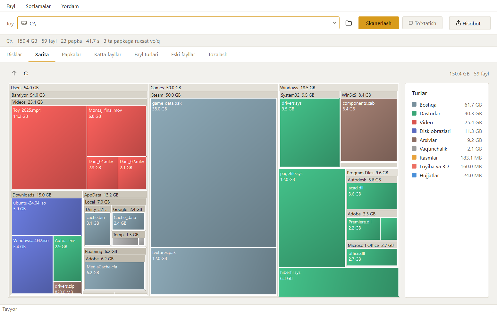
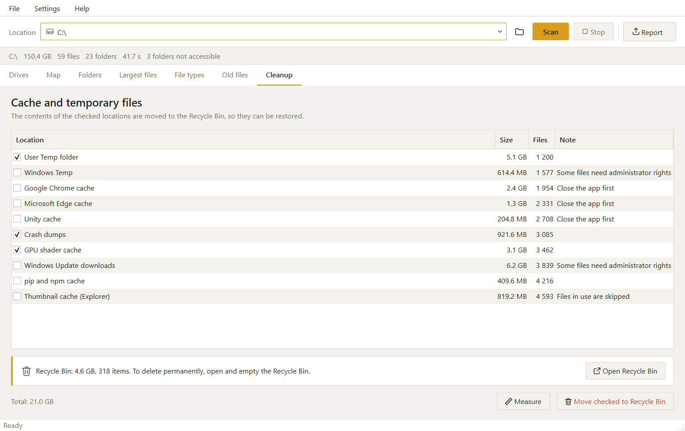

# Disk tahlilchisi: Uslubiy ko‘rsatma

Muallif: Hakimov Bahtiyorjon. Versiya: 1.0.2.

## 1. Uslubiy ko‘rsatmaning maqsadi va vazifalari

Ushbu uslubiy ko‘rsatma oliy ta’lim muassasalari, kollej va texnikumlar o‘qituvchilari hamda tashkilotlarning axborot texnologiyalari bo‘yicha mutaxassislari uchun “Disk tahlilchisi” dasturidan o‘quv va kasbiy faoliyatda foydalanish tartibini belgilaydi.

Ko‘rsatmaning maqsadi talabalarda fayl tizimi tuzilishi, disk maydonini tahlil qilish va keraksiz ma’lumotlarni xavfsiz olib tashlash bo‘yicha amaliy ko‘nikmalarni shakllantirishdir.

Vazifalar:

- papka, fayl, kengaytma, hajm o‘lchov birliklari va fayl atributlari (o‘zgartirilgan va oxirgi ochilgan sana) tushunchalarini amaliy misolda mustahkamlash;
- ma’lumotlarni vizual tahlil qilish usuli sifatida treemap (to‘rtburchaklar xaritasi) bilan tanishtirish;
- kesh, vaqtinchalik fayllar va Savat vazifasini tushuntirish;
- o‘chirish amallarida xavfsizlik qoidalari va tasdiqlash madaniyatini shakllantirish;
- tahlil natijalarini HTML va CSV hisobot ko‘rinishida rasmiylashtirishni o‘rgatish.
Ko‘rsatma dasturning haqiqiy imkoniyatlariga tayanadi: barcha topshiriqlar dasturdagi mavjud sahifalar va tugmalar orqali bajariladi. Mashg‘ulotlarda talabalar natijalarni nafaqat ekranda kuzatadi, balki ularni hisobot ko‘rinishida rasmiylashtiradi, taqqoslaydi va xulosa chiqaradi. Bu esa axborot texnologiyalari bo‘yicha mutaxassis uchun zarur bo‘lgan tahliliy fikrlash va hujjatlashtirish ko‘nikmalarini rivojlantiradi.

## 2. Qo‘llash sohasi va maqsadli auditoriya

Dastur quyidagi fanlar va mavzularni o‘qitishda qo‘llanishi mumkin:

- “Informatika va axborot texnologiyalari”: fayl tizimi, papkalar ierarxiyasi, ma’lumot hajmi birliklari;
- “Operatsion tizimlar”: Windows papkalari tuzilishi, foydalanuvchi profili, vaqtinchalik fayllar, ruxsatlar va reparse point (junction, symlink) tushunchasi;
- “Kompyuter tizimlariga texnik xizmat ko‘rsatish”: disk maydonini bo‘shatish, kesh tozalash, hisobot tayyorlash;
- “Ma’lumotlarni vizuallashtirish”: treemap usuli va squarified algoritmi g‘oyasi;
- “Axborot xavfsizligi asoslari”: ma’lumotlarni qaytarib bo‘lmaydigan yo‘qotishning oldini olish choralari.
Maqsadli auditoriya: kompyuter injiniringi, axborot texnologiyalari, dasturiy injiniring yo‘nalishlari talabalari, kasb-hunar ta’limi o‘quvchilari, shuningdek, tashkilotlarda kompyuter parkiga xizmat ko‘rsatuvchi mutaxassislar. Kasbiy faoliyatda dastur ish o‘rinlaridagi disklar holatini tekshirish, to‘lib qolgan tizim diskini bo‘shatish va rahbariyatga hisobot tayyorlash uchun ishlatiladi.

Tashkilot mutaxassislari uchun tavsiya etiladigan ish tartibi: avval “Disklar” sahifasida to‘lib qolgan diskni aniqlash, so‘ng uni skanerlash va xarita orqali eng katta papkalarni topish, keyin “Katta fayllar” va “Eski fayllar” sahifalarida foydalanuvchi bilan kelishilgan holda keraksiz fayllarni ajratish, oxirida esa “Tozalash” sahifasida kesh va vaqtinchalik fayllarni tozalash va natijani HTML hisobot sifatida saqlash. Bunday tartib foydalanuvchi ma’lumotlarini kelishuvsiz o‘chirishning oldini oladi.

## 3. O‘quv mashg‘ulotida foydalanish tartibi

Quyida 80 daqiqalik amaliy mashg‘ulot rejasi keltirilgan. Mashg‘ulot uchun har bir kompyuterda dastur fayli bo‘lishi va talabalar uchun alohida o‘quv papkasi (masalan, turli hajmdagi fayllar nusxalangan papka) tayyorlab qo‘yilishi tavsiya etiladi.

1. Tashkiliy qism (5 daqiqa): davomatni tekshirish, mashg‘ulot maqsadi va xavfsizlik qoidalari bilan tanishtirish. O‘qituvchi tozalash amallari faqat o‘quv papkasida va o‘qituvchi ruxsati bilan bajarilishini alohida ta’kidlaydi.
2. Nazariy qism (20 daqiqa): fayl tizimi ierarxiyasi, papka hajmi qanday hisoblanishi, bayt, KB, MB, GB birliklari, kesh va vaqtinchalik fayllar vazifasi, Savat ishlash tamoyili, treemap usuli va to‘rtburchak maydonining hajmga proporsionalligi. Dastur oynasi proyektor orqali namoyish qilinadi.
3. Amaliy qism (45 daqiqa): talabalar dasturni ishga tushiradi, avval “Disklar” sahifasida disklar holatini tahlil qiladi, so‘ng o‘quv papkasini skanerlaydi, “Xarita”, “Papkalar”, “Katta fayllar”, “Fayl turlari” va “Eski fayllar” sahifalari bo‘yicha topshiriqlarni bajaradi, HTML va CSV hisobot saqlaydi. Tozalash bo‘yicha topshiriq faqat “Hajmini hisoblash” bosqichigacha yoki o‘qituvchi ruxsat bergan joylar uchun bajariladi.
4. Yakuniy qism (10 daqiqa): natijalarni muhokama qilish, hisobotlarni tekshirish, nazorat savollariga javob berish va mustaqil ish topshirig‘ini berish.
O‘qituvchi uchun tayyorgarlik tavsiyalari: o‘quv papkasiga turli toifadagi fayllarni (video, rasm, hujjat, arxiv, vaqtinchalik) va bir nechta ichki papkalarni joylashtirish; papkani har bir talaba kompyuteriga nusxalash; mashg‘ulot oxirida papkani dastlabki holatiga qaytarish uchun zaxira nusxani saqlash. Amaliy qismda talabalar juftlikda ishlashi mumkin: biri amallarni bajaradi, ikkinchisi natijalarni hisobot jadvaliga yozadi, keyingi topshiriqda rollar almashadi. Mashg‘ulot davomida o‘qituvchi har bir juftlikning hisobot fayllarini tekshirib boradi.

Nazariy qismda himoya mexanizmini ko‘rsatish uchun o‘qituvchi, masalan, “Papkalar” sahifasida Windows papkasi ustida “Savatga yuborish” bandini tanlab, “Bu tizim joyi, uni o‘chirib bo‘lmaydi” xabarini namoyish qilishi mumkin. Bu amal hech qanday faylni o‘zgartirmaydi, chunki tekshiruv tasdiqlash oynasidan oldin bajariladi.

Mashg‘ulotni tashkil etishda dasturning quyidagi xususiyatlarini hisobga olish foydali: skanerlash istalgan vaqtda “To‘xtatish” tugmasi bilan to‘xtatiladi va qisman natija ko‘rsatiladi; natija satrida skanerlashga sarflangan soniyalar chiqadi, bu talabalarga turli hajmdagi papkalarni skanerlash vaqtini solishtirish imkonini beradi; “Eski fayllar” sahifasidagi minimal hajm va kunlar soni sozlamalarda saqlanadi, shuning uchun har bir guruhdan oldin standart qiymatlarni (100 MB va 180 kun) qayta o‘rnatish tavsiya etiladi.

*1-rasm. Nazariy qismda namoyish uchun “Xarita” sahifasi: to‘rtburchak maydoni papka va fayl hajmiga mos*

## 4. Amaliy topshiriqlar

Topshiriqlar murakkablik ortib borishi tartibida joylashtirilgan. Har bir topshiriq natijasi daftarga yoki elektron hisobot shakliga yoziladi, talaba olgan raqamlarini dastur ekranidagi qiymatlar bilan asoslashi kerak.

1. **Disklar holatini aniqlash.** “Disklar” sahifasida kompyuterdagi har bir diskning fayl tizimi, umumiy, band va bo‘sh hajmini daftarga yozing. Kutilgan natija: har bir disk uchun to‘rtta ko‘rsatkich va band joy foizi.
2. **O‘quv papkasini skanerlash.** Papka tanlash tugmasi orqali o‘quv papkasini tanlang va skanerlang. Natija satridagi umumiy hajm, fayllar va papkalar sonini, sarflangan vaqtni yozing. Kutilgan natija: natija satri ma’lumotlari va ularning Explorer’dagi papka xususiyatlari bilan taqqoslanishi.
3. **Xarita orqali eng katta papkani topish.** “Xarita” sahifasida eng katta to‘rtburchakni aniqlang, uning ichiga kiring va eng katta faylni toping. Kutilgan natija: eng katta papka va fayl nomi hamda hajmi, “Yuqoriga” tugmasi bilan qaytish.
4. **Daraxtni saralash.** “Papkalar” sahifasida ro‘yxatni “Hajmi”, “Fayllar” va “O‘zgartirilgan” ustunlari bo‘yicha navbat bilan saralang. Kutilgan natija: eng ko‘p faylga ega va eng yaqinda o‘zgartirilgan papkalar nomi; hajm bo‘yicha va fayllar soni bo‘yicha birinchi o‘rindagi papka bir xil bo‘lmasligi mumkinligini tushuntirish.
5. **Fayl turlari tahlili.** “Fayl turlari” sahifasi bo‘yicha eng ko‘p joy egallagan uchta toifa va uchta kengaytmani aniqlang. Kutilgan natija: toifalar va kengaytmalar ro‘yxati, ularning ulushi foizda.
6. **Eski fayllarni aniqlash.** “Eski fayllar” sahifasida minimal hajmni 10 MB qilib, avval “Oxirgi ochilgan sana”, so‘ng “O‘zgartirilgan sana” mezoni bo‘yicha ro‘yxat oling. Kutilgan natija: ikki ro‘yxat orasidagi farq va Windows oxirgi ochilgan sanani har doim yangilamasligi haqidagi xulosa.
7. **Hisobot tayyorlash.** Skanerlash natijasini HTML va CSV formatida saqlang, CSV faylni jadval dasturida ochib, eng katta 5 ta faylni ajrating. Kutilgan natija: ikkita hisobot fayli va eng katta fayllar jadvali.
8. **Tozalashni rejalashtirish.** “Tozalash” sahifasida “Hajmini hisoblash” tugmasini bosib, qaysi joy eng ko‘p joy egallashini aniqlang va har bir joyning “Izoh” ustunidagi ogohlantirish nimani anglatishini yozing. Kutilgan natija: tozalash rejasi, administrator huquqi talab qilinadigan joylar va avval yopilishi kerak bo‘lgan dasturlar ro‘yxati.

## 5. Baholash mezonlari

Amaliy mashg‘ulot 100 ball tizimida baholanadi:

- disklar holati va skanerlash natijalarini to‘g‘ri aniqlash va qayd etish (1–2-topshiriqlar): 20 ball;
- xarita va papkalar daraxti bilan ishlash, eng katta papka va fayllarni topish (3–4-topshiriqlar): 20 ball;
- fayl turlari va eski fayllar tahlili, xulosalarning asoslanganligi (5–6-topshiriqlar): 20 ball;
- HTML va CSV hisobotlarni tayyorlash va ularni tahlil qilish (7-topshiriq): 15 ball;
- tozalash rejasini tuzish va xavfsizlik qoidalariga rioya qilish (8-topshiriq): 15 ball;
- nazorat savollariga javoblar: 10 ball.
Natija: 86–100 ball “a’lo”, 71–85 ball “yaxshi”, 55–70 ball “qoniqarli”, 55 balldan kam “qoniqarsiz”. Xavfsizlik qoidalarini qo‘pol buzish (o‘qituvchi ruxsatisiz o‘quv papkasidan tashqaridagi fayllarni o‘chirish) tozalash bo‘yicha topshiriq balini nolga tushiradi.

Baholashda natijalarning to‘g‘riligi bilan birga talabaning xulosalarni asoslay olishi, hisobotlarning tartibli rasmiylashtirilgani va amallarni bajarishda ehtiyotkorlikka rioya qilgani hisobga olinadi.

## 6. Nazorat savollari

Quyidagi savollar mashg‘ulot yakunida og‘zaki so‘rov yoki yozma test shaklida qo‘llanishi mumkin. Javoblarda talaba dasturdagi aniq sahifa va tugmalarga tayanishi kerak.

1. Papkaning to‘liq hajmi qanday hisoblanadi va nima uchun Explorer ro‘yxatida u darhol ko‘rinmaydi?
2. Treemap usulida to‘rtburchak maydoni nimani ifodalaydi?
3. Squarified treemap algoritmi oddiy bo‘laklarga ajratishdan nimasi bilan farq qiladi?
4. Nima uchun skaner junction va symlink’lar ichiga kirmaydi?
5. Fayllarning o‘zgartirilgan va oxirgi ochilgan sanalari o‘rtasida qanday farq bor?
6. Kesh va vaqtinchalik fayllar nima uchun yaratiladi va ularni o‘chirish qanday oqibatlarga olib kelishi mumkin?
7. Savatga yuborish va butunlay o‘chirishning farqi nimada? Savatga yuborilgan fayl diskda joy egallaydimi?
8. Dasturda qaysi papkalar o‘chirishdan himoyalangan va nima uchun?
9. HTML va CSV hisobotlar qaysi vazifalar uchun qulay?
10. Nima uchun ba’zi papkalar “ruxsat yo‘q” deb hisoblanadi?
11. Nima uchun dastur “Tozalash” sahifasida papkalarning o‘zini emas, faqat ichidagi fayllarni Savatga yuboradi?
12. “Eski fayllar” sahifasida qaysi mezonlar bo‘yicha tanlov bajariladi va ularning standart qiymatlari qanday?

## 7. Mustaqil ish uchun tavsiyalar

- Uy kompyuteringizdagi Yuklamalar va Hujjatlar papkalarini skanerlab, eng ko‘p joy egallagan fayl toifalari bo‘yicha qisqa tahliliy yozuv tayyorlang.
- Bir xil papkani turli vaqtda ikki marta skanerlab, CSV hisobotlar asosida hajm o‘zgarishini jadvalda taqqoslang.
- Treemap usuli va squarified algoritmi bo‘yicha manbalarni o‘rganib, to‘rtburchaklar nisbati nima uchun muhimligini tushuntiruvchi referat yozing.
- Ish joyidagi kompyuterlar uchun disk maydonini muntazam tekshirish va xavfsiz tozalash bo‘yicha ichki yo‘riqnoma loyihasini tuzing.
- Brauzer keshining vazifasini o‘rganib, keshni tozalashning afzalliklari va kamchiliklarini tavsiflang.
- “Tozalash” ro‘yxatidagi har bir joy (masalan, videokarta sheyder keshi, Windows Update yuklamalari, Explorer eskizlar keshi) qaysi dastur tomonidan yaratilishi va o‘chirilgandan keyin qayta yaratilishi haqida qisqa ma’lumotnoma tayyorlang.
- Dastur interfeysini uch tilda ko‘rib chiqib, disk tahlili atamalarining o‘zbek, rus va ingliz tillaridagi moslik lug‘atini tuzing.

## 8. Xavfsizlik va axborot madaniyati qoidalari

Disk maydonini tahlil qilish va tozalash amallari foydalanuvchi ma’lumotlari bilan bevosita bog‘liq, shuning uchun mashg‘ulotda texnik ko‘nikmalar bilan birga mas’uliyatli munosabat ham shakllantiriladi. Dasturda o‘rnatilgan himoya choralari (faqat Savatga yuborish, tasdiqlash oynasi, tizim papkalarini himoyalash) xatolik xavfini kamaytiradi, lekin foydalanuvchining e’tiborini almashtirmaydi. O‘qituvchi talabalarga bu choralarni ko‘rsatib, nima uchun ular kerakligini tushuntirishi tavsiya etiladi.

- O‘quv mashg‘ulotida o‘chirish amallari faqat maxsus tayyorlangan o‘quv papkasida va o‘qituvchi ruxsati bilan bajariladi.
- Har bir tasdiqlash oynasidagi ro‘yxatni o‘qib chiqmasdan rozilik bermang.
- Boshqa foydalanuvchilar fayllari va umumiy kompyuterlardagi ma’lumotlarni ularning egasi ruxsatisiz o‘chirmang.
- Brauzer va boshqa dasturlar keshini tozalashdan oldin ularni yoping, ochiq hujjatlarni saqlang.
- Savatni butunlay tozalashdan oldin undagi fayllar haqiqatan keraksizligiga ishonch hosil qiling: Savat tozalangandan keyin fayllarni dastur yordamida qaytarib bo‘lmaydi.
- Hisobotlarda fayl va papka nomlari, ya’ni shaxsiy ma’lumotlar bo‘lishi mumkin; ularni uchinchi shaxslarga berishdan oldin mazmunini tekshiring.
- Muhim ma’lumotlarning zaxira nusxasini muntazam yaratib boring.
- Administrator huquqi talab qilinadigan tizim joylarini (Windows Temp, Windows Update yuklamalari) tozalashni faqat tashkilotning texnik xizmati bilan kelishgan holda bajaring.
- Ish joyidagi kompyuterda tozalash bajarilgan bo‘lsa, saqlangan HTML hisobot orqali qanday joylar tozalangani va qancha joy bo‘shagani haqida mas’ul shaxsga ma’lumot bering.
- Dasturni faqat rasmiy GitHub sahifasidan yuklab oling.

*2-rasm. Tozalash sahifasi: tozalanadigan joylar va izohlar, Savat holati va Savatga yuborish tugmasi (ingliz tilidagi interfeys)*

